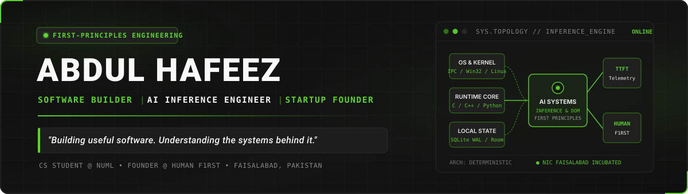
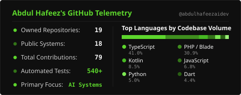
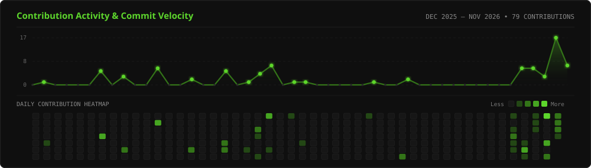

<div align="center">

  <!-- 1. HEADER / CUSTOM BANNER -->
  

  <br />

  <!-- QUICK POSITIONING PILLS -->
  <p>
    
    
    
    
  </p>

</div>


## `01` // Introduction — About Me

> **"Building useful software. Understanding the systems behind it."**

I am a **Computer Science student**, **software builder**, and **startup founder** driven by a first-principles approach to technology. Rather than treating high-level frameworks as black boxes, I focus on understanding how software operates across process boundaries, operating systems, network protocols, and compute runtimes.

- **Founder of [HUMAN F1RST](https://humanf1rst.app)** — an educational technology platform for ethical and responsible AI usage in academic institutions, accepted into **NIC Faisalabad's incubation program**.
- **Engineering Interests** — Software architecture, systems engineering, AI infrastructure, deterministic local-first runtimes, and developer tooling.
- **Long-Term Technical Direction** — Developing foundational capability in **AI Systems and Inference Engineering**, progressing from asynchronous streaming client pipelines toward low-level systems and GPU compute.
- **Open-Source & Practical Software** — Committed to building well-tested, practical tools that solve tangible engineering and human problems.


## `02` // Current Focus

```yaml
engineering_direction: "AI Systems & Inference Engineering"
approach:              "First-Principles Systems Understanding"

active_priorities:
  venture:             "HUMAN F1RST — Ethical AI Governance for Education (NIC Faisalabad)"
  systems_engineering: "Deterministic Local Runtimes, Compiler Pipelines & Developer Tooling"
  learning_track:      "C/C++, Linux Systems, Computer Architecture, Networking & GPU Inference"
```

| Domain | Current Engineering & Study Focus | Status |
| :--- | :--- | :--- |
| **Ethical AI in Education** | Building **HUMAN F1RST** to help institutions guide responsible student AI usage without invasive surveillance. | `Active Venture · NIC Incubated` |
| **AI Inference Foundations** | Studying token streaming telemetry (`TTFT`), model serving pipelines, and low-level systems foundations (`C/C++`, `Linux`, `CUDA`). | `Ongoing Learning Journey` |
| **Developer & OS Systems** | Designing local-first desktop architectures, multi-process IPC runtimes, and semantic DOM compiler tools. | `Active Engineering` |


## `03` // What I'm Building — Featured Projects

### Core Ventures, Systems Architecture & Learning Tracks

<table>
  <tr>
    <td width="50%" valign="top">
      <h3><a href="https://humanf1rst.app">HUMAN F1RST</a></h3>
      <p><b>Ethical AI Usage Platform for Educational Institutions</b></p>
      <p><i>"Humans lead. AI follows."</i></p>
      <ul>
        <li><b>Mission</b>: Help students benefit from AI without allowing AI to replace their creativity and independent thinking.</li>
        <li>Provides structured Assignment and Exam Modes that enable AI-assisted learning when appropriate while protecting assessment integrity without invasive surveillance.</li>
        <li>Accepted into <b>NIC Faisalabad's incubation program</b>.</li>
      </ul>
      <p>
        <b>Links</b>: <a href="https://humanf1rst.app">Website (humanf1rst.app)</a> · <a href="https://github.com/abdulhafeezaidev/humanf1rst">Web Repository</a>
      </p>
    </td>
    <td width="50%" valign="top">
      <h3>Windows Developer Package Manager (DevPkg Windows)</h3>
      <p><b>Package Management &amp; Developer Workflow Architecture on Windows</b></p>
      <p><i>Status: Architecture &amp; System Design Completed — Paused at G3 Approval Gate</i></p>
      <ul>
        <li>Engineered a cross-ecosystem package and dependency graph inspector (<code>npm</code> &amp; <code>pip</code>) with epistemic confidence classification for direct, transitive, and orphaned packages.</li>
        <li>Designed with Windows process lock detection and safe cache reclamation workflows.</li>
        <li><i>Note: Currently paused at its G3 human approval gate; not a finished or production-released application.</i></li>
      </ul>
      <p>
        <b>Stack</b>: <code>TypeScript</code> · <code>Node.js</code> · <code>Electron</code> · <code>React</code> · <code>Vitest</code>
      </p>
    </td>
  </tr>
  <tr>
    <td colspan="2" valign="top">
      <h3><a href="https://github.com/abdulhafeezaidev/AI-Inference-Engineering">AI Inference Engineering</a></h3>
      <p><b>Ongoing Technical Learning &amp; Engineering Journey into AI Inference Systems</b></p>
      <p>
        A structured, ground-up learning journey and experimental repository focused on understanding the foundations of AI inference systems from first principles. Currently implemented an asynchronous Python streaming client (<code>httpx</code>, <code>asyncio</code>) for capturing nanosecond-accurate Time-To-First-Token (<code>TTFT</code>) and token latency telemetry, alongside containerized GPU serving experiments.
      </p>
      <p>
        <b>Foundational Areas of Study</b>:
        <code>C &amp; C++</code> · <code>Linux &amp; Operating Systems</code> · <code>Computer Architecture</code> · <code>Networking</code> · <code>Distributed Systems</code> · <code>GPU Computing</code> · <code>Machine Learning Inference</code>
      </p>
      <p>
        <b>Repository</b>: <a href="https://github.com/abdulhafeezaidev/AI-Inference-Engineering">github.com/abdulhafeezaidev/AI-Inference-Engineering</a>
      </p>
    </td>
  </tr>
</table>

### Additional Selected Open-Source Repositories

<table>
  <tr>
    <td width="50%" valign="top">
      <h4><a href="https://github.com/abdulhafeezaidev/personal-agent">Personal Agent</a></h4>
      <p><b>Deterministic Windows Desktop Automation Runtime</b></p>
      <p>Supervisor/worker desktop runtime utilizing Win32 API session validation, Windows Named Pipes IPC (<code>\\.\pipe\personal_agent_ipc</code>), and transactional SQLite WAL state persistence.</p>
      <p><code>Python</code> · <code>Win32 API</code> · <code>Named Pipes IPC</code> · <code>SQLite WAL</code> · <code>Pytest</code></p>
    </td>
    <td width="50%" valign="top">
      <h4><a href="https://github.com/abdulhafeezaidev/ui-ux-helper-extension">AI Design Compiler (UI/UX Helper)</a></h4>
      <p><b>Multi-Pass Chromium DOM-to-Design Contract Compiler</b></p>
      <p>6-stage browser compiler pipeline that transforms live rendered DOM trees into compact semantic design contracts, layout constraint graphs, and declarative tokens. Backed by 540+ automated tests.</p>
      <p><code>TypeScript</code> · <code>Manifest V3</code> · <code>Vite</code> · <code>Vitest</code> · <code>JSDOM</code></p>
    </td>
  </tr>
  <tr>
    <td width="50%" valign="top">
      <h4><a href="https://github.com/abdulhafeezaidev/SavingYouth">SavingYouth — Behavioral Firewall</a></h4>
      <p><b>Local-First Android Digital Safety Engine</b></p>
      <p>Privacy-preserving on-device heuristic interception engine for Android featuring encrypted local storage (Room + SQLCipher) and batched, compressed telemetry synchronization via Appwrite.</p>
      <p><code>Kotlin</code> · <code>Jetpack Compose</code> · <code>Room DB</code> · <code>SQLCipher</code> · <code>Hilt</code></p>
    </td>
    <td width="50%" valign="top">
      <h4><a href="https://github.com/abdulhafeezaidev/roman-urdu-translator">Roman Urdu Technical Translator</a></h4>
      <p><b>In-Place Documentation Translator &amp; Native Messaging Proxy</b></p>
      <p>Manifest V3 Chrome extension and Windows Native Messaging Host that translates English technical documentation into Roman Urdu in-place while preserving <code>&lt;code&gt;</code> blocks and CLI syntax.</p>
      <p><code>JavaScript</code> · <code>Node.js</code> · <code>Manifest V3</code> · <code>Gemini API</code> · <code>Groq</code></p>
    </td>
  </tr>
</table>


## `04` // Technology Stack & Arsenal

Every technology listed below is verified against my active repositories and current coursework. Technologies I use in built projects are strictly separated from foundational domains I am actively studying.

### Actively Used in Projects

| Category | Verified Technologies & Tools |
| :--- | :--- |
| **Programming Languages** |        |
| **Backend & Software Dev** |         |
| **AI & Machine Learning** |      |
| **Systems & Infrastructure** |     |
| **Databases & Storage** | -202020?style=flat-square&logo=sqlite&logoColor=5DD62C)  -202020?style=flat-square&logo=supabase&logoColor=5DD62C)    |
| **Developer Tools & Testing** |       |

### Currently Learning & Exploring (Foundational Track)

| Focus Area | Technologies & Core Concepts Under Study |
| :--- | :--- |
| **Systems Programming** |    Memory management, pointers, compilation toolchains, and systems-level performance. |
| **OS & Architecture** |  Process scheduling, virtual memory, file descriptors, CPU caches, and computer architecture. |
| **AI Inference & Compute** | -161616?style=flat-square&logo=nvidia&logoColor=337418) Transformer attention mechanics, KV-cache behavior, distributed systems, networking, and model serving runtimes. |


## `05` // GitHub Statistics

<div align="center">
  <a href="https://github.com/abdulhafeezaidev">
    
  </a>
  <a href="https://github.com/abdulhafeezaidev">
    
  </a>
</div>

<details>
  <summary><b>View Text-Based Telemetry &amp; Language Breakdown (Fallback)</b></summary>
  <br />

  | Metric | Value | Primary Languages (by Code Volume) | Share |
  | :--- | :--- | :--- | :--- |
  | **Owned Repositories** | `19` (`18 Public`) | **TypeScript** | `41.0%` |
  | **Total Contributions** | `79` (Dec 2025 – Present) | **PHP / Blade** | `30.9%` |
  | **Automated Test Coverage** | `540+ Unit/Integration Tests` | **Kotlin** | `8.5%` |
  | **Primary Technical Focus** | `AI Systems & Inference` | **JavaScript / Python / Dart / C++** | `19.6%` |

</details>


## `06` // Contribution Activity

<div align="center">
  
</div>


## `07` // Connect With Me

I am always open to discussing **software architecture**, **AI inference systems**, **educational technology**, and **open-source engineering**.

<div align="center">

  <a href="https://www.linkedin.com/in/abdul-hafeez-60725b345">
    
  </a>
  &nbsp;
  <a href="mailto:abdulhafeez.ai.dev@gmail.com">
    
  </a>
  &nbsp;
  <a href="https://humanf1rst.app">
    
  </a>
  &nbsp;
  <a href="https://abdulhafeezaidev.github.io/Personal-Portfolio/">
    
  </a>

</div>

---

<div align="center">
  <sub>Designed &amp; engineered by <b>Abdul Hafeez</b> · Built from first principles.</sub>
</div>
